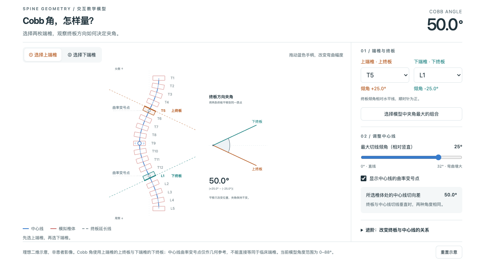

# 脊柱几何实验室 · Spine Geometry Lab

用于讲解 **Cobb 角、椎体终板方向、中心线曲率与侧向幅度** 的交互式网页。纯 HTML、CSS 和 JavaScript，无后端、无需构建，可部署到静态网站。

**[打开在线演示](https://spine-curvature-demo.jonasxue009.chatgpt.site/)** · **[独立 Cobb 测量组件](https://spine-curvature-demo.jonasxue009.chatgpt.site/cobb.html)** · [模型与计算说明](docs/MODEL.md)



> 这是理想二维教学模型，使用合成曲线和模拟椎体，不包含患者影像或测量数据。它不提供临床自动选椎、诊断或手术固定节段建议。

## 可以做什么

- **Cobb 角测量**：点击或通过下拉菜单选择上下端椎，显示上端椎的上终板、下端椎的下终板、延长线及夹角。
- **实时调整曲线**：拖动蓝色手柄，或调整最大切线倾角滑块，观察角度变化。
- **比较几何与终板**：显示中心线曲率变号点；单独旋转所选模拟椎体，比较终板 Cobb 角与中心线切向差。
- **曲率与幅度**：在第二个标签页比较“幅度减小”和“曲率变号”，并移动观察位置。
- **适配不同窗口**：支持桌面、手机窄屏和键盘操作；独立测量组件提供适合演示的布局。

## 本地运行

需要 Python 3，以及支持现代 JavaScript 和 SVG 的浏览器。

```bash
git clone https://github.com/jcoctnine/spine-geometry-lab.git
cd spine-geometry-lab
python3 -m http.server 8000 --bind 127.0.0.1 --directory dist
```

然后打开：

- 完整实验室：<http://127.0.0.1:8000/>
- 独立测量组件：<http://127.0.0.1:8000/cobb.html>

按 `Ctrl+C` 停止服务。建议通过 HTTP 服务打开，避免 `file://` 下 iframe 和浏览器安全策略的差异。运行不需要 GitHub 登录、API 密钥或数据库。

`cobb.html` 自包含，不依赖第三方脚本。“曲率与幅度”导出组件保留了来自 UNPKG 的脚本引用，完整页面不保证完全离线可用，详见 [第三方声明](THIRD_PARTY_NOTICES.md)。

## 操作示例

1. 默认选中 T5 与 L1，两条终板倾角为 +25° 和 −25°，Cobb 角为 **50°**。
2. 把下端椎改为 T9，Cobb 角变为 **25°**。
3. 把最大切线倾角调为 0°，中心线变直，曲率变号点消失。
4. 展开“进阶”，改变端椎方向偏移：中心线保持不变，Cobb 角随终板方向变化。

“选择模型中夹角最大的组合”只遍历当前模拟椎体，并不实现临床选椎规则。曲率变号点也不直接等同于临床端椎。

## 静态部署与 PPT

将 `dist/` 内的文件作为网站根目录部署到任意支持静态 HTML 的 HTTPS 主机。入口为 `index.html`，无需安装依赖或运行打包命令。

在支持网页显示的 PowerPoint 加载项中，可以尝试使用独立组件的 HTTPS 地址。组件已在浏览器的 1280×720 窗口检查，**尚未在 Mac PowerPoint 加载项中实测**；是否可交互取决于加载项、网络和 PowerPoint 版本。也可以在幻灯片中放置网页超链接。

本仓库发布源码，不会自动更新现有 Sites 网站，也没有自动部署流程。

## 项目结构

```text
dist/
  index.html              # 实验室入口与原曲率组件的沙盒包装
  cobb.html               # 独立 Cobb 角交互模型
docs/
  MODEL.md                # 数学模型、坐标约定与适用范围
  preview.png             # 合成教学模型截图
LICENSE                   # MIT 许可证
THIRD_PARTY_NOTICES.md     # 第三方资源与许可证说明
```

两个 HTML 文件与首次开源时的线上源文件逐字节一致。保留了原有 `sandbox="allow-scripts"` iframe、CSP、消息来源检查和组件行为；Sites 项目标识、部署配置、凭据、本地历史与研究资料不属于本开源包。

## 验证与贡献

发布前已检查初始 50°、换选端椎后的 25°、直线 0°、允许范围边界 88°、终板线方向与角度读数一致性，以及点击、拖动、键盘、端椎顺序限制和窄屏布局。源码发布时另做文件一致性与敏感信息检查。这些是教学软件检查，不是临床有效性验证。

欢迎提交 Issue 或 Pull Request。涉及数学修改时，请说明坐标与角度约定，附上可复现的参数组合，并验证直线状态、端椎顺序和角弧方向。请不要在 Issue 中上传可识别患者的影像或信息。

## License

项目原创代码和文档采用 [MIT License](LICENSE)。保留的导出运行时包装及第三方依赖不因本仓库而重新许可，相关权利归原权利人；第三方依赖保留各自许可证，见 [THIRD_PARTY_NOTICES.md](THIRD_PARTY_NOTICES.md)。

---

**English:** A browser-based educational playground for Cobb angle measurement, vertebral endplate orientation, and spinal centerline curvature. Built with plain HTML/CSS/JavaScript. Synthetic 2D demonstrations only; not a clinical measurement or surgical planning system. Run a static server for `dist/`, or use the hosted demo above.
